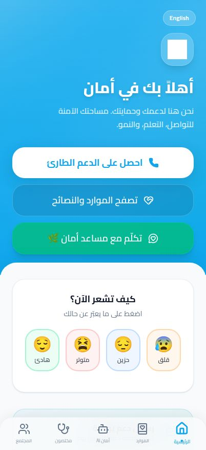
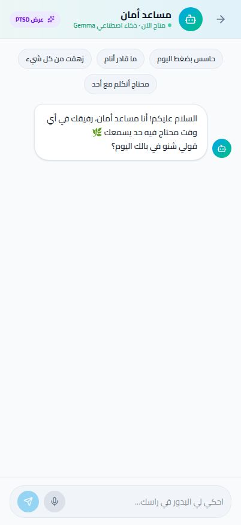

# أمان | Amān


**أمان** تطبيق دعم نفسي رقمي ثنائي اللغة، صُمم لمساندة المستخدمين بالعربية السودانية والإنجليزية. يجمع أدوات العناية اليومية بالذات، والمحتوى التوعوي، والتواصل المجتمعي، ومساعداً حوارياً ذكياً في مكان واحد، مع التأكيد أن التطبيق لا يحل محل الرعاية النفسية أو الطبية المتخصصة.

## لقطات من التطبيق

### الصفحة الرئيسية



### المساعد الذكي



## الميزات الرئيسية

- مساعد محادثة ذكي يدعم العربية السودانية والإنجليزية.
- تسجيل الحالة المزاجية ومتابعة المؤشرات والإحصاءات.
- موارد ومقالات توعوية وتمارين للتعامل مع الضغوط.
- مجتمع وورش عمل وأنشطة داعمة.
- مراسلة المختصين.
- واجهة ثنائية اللغة تدعم اتجاه الكتابة من اليمين إلى اليسار، ومهيأة أساساً للهواتف.
- لوحة معلومات منفصلة مبنية باستخدام Streamlit.

## التقنيات المستخدمة

| المجال | التقنيات |
| --- | --- |
| واجهة المستخدم | React 18، TypeScript، Vite، Tailwind CSS |
| الخادم وواجهات API | Node.js، Express 5، TypeScript |
| قاعدة البيانات | PostgreSQL، Drizzle ORM |
| الذكاء الاصطناعي | Google GenAI، Gemma |
| الاختبارات | Vitest |
| لوحة المعلومات | Python، Streamlit |
| إدارة الحزم | pnpm workspaces |

## البنية العامة

- `artifacts/aman-app` — تطبيق الويب.
- `artifacts/api-server` — خادم واجهات API.
- `artifacts/aman-dashboard` — لوحة المعلومات المبنية بـ Streamlit.
- `lib/db` — مخططات واتصال قاعدة البيانات.
- `lib/api-spec` و`lib/api-client-react` و`lib/api-zod` — عقد API والأنواع والعملاء المولّدة.

## مساهمتي بصفتي مهندس بنية النظام (System Architect)

صممتُ أمان كنظام متكامل، لا كواجهة منفردة: فصلت تطبيق المستخدم عن خادم API ولوحة المعلومات، وربطت الخدمات بطبقة بيانات PostgreSQL، وحددت تقنيات مشتركة وعقداً لواجهات API قابلة للتوليد. كما راعيت منذ البداية دعم العربية والإنجليزية، وتجربة الهواتف، وإمكانية توسيع وحدات الدعم النفسي والمجتمعي دون خلط مسؤولياتها.

## متطلبات التشغيل

- Node.js 24 أو إصدار متوافق مع إعدادات المشروع.
- pnpm 9.
- PostgreSQL مع `DATABASE_URL`.
- متغير `Gemini_API_KEY` للمحادثة الذكية؛ يقبل الخادم أيضاً `GEMINI_API_KEY`.

لا تضع مفاتيح أو بيانات اعتماد داخل ملفات الكود أو README. أضفها إلى Secrets في Replit أو إلى بيئة التشغيل المحلية الآمنة.

## التثبيت والتشغيل

من مجلد المشروع:

```bash
pnpm install
```

في Replit، شغّل التطبيق باستخدام زر **Run** لبدء الخدمات المُعدة للمشروع. ولتشغيل الخدمات منفردة في بيئة تطوير:

```bash
# خادم API
pnpm --filter @workspace/api-server run dev

# تطبيق الويب
pnpm --filter @workspace/aman-app run dev
```

تحتاج لوحة المعلومات إلى Python والحزم المحددة في `artifacts/aman-dashboard/requirements.txt`، وتُشغّل من مجلدها:

```bash
cd artifacts/aman-dashboard
streamlit run app.py
```

## الاختبارات والتحقق

تشغيل اختبارات المشروع:

```bash
pnpm test
```

فحص أنواع TypeScript:

```bash
pnpm run typecheck
```

تغطي اختبارات Vitest وظائف مثل التحقق من بيانات المزاج، وتوقيع رموز الدخول، ورصد تتابع الأيام ذات المزاج المنخفض، وتنظيف ردود المساعد الذكي.

## ملاحظة مهمة

أمان أداة دعم وتثقيف، وليس خدمة طوارئ أو بديلاً عن التشخيص والعلاج لدى مختص. عند وجود خطر مباشر، تواصل مع خدمات الطوارئ أو جهة دعم محلية موثوقة.
